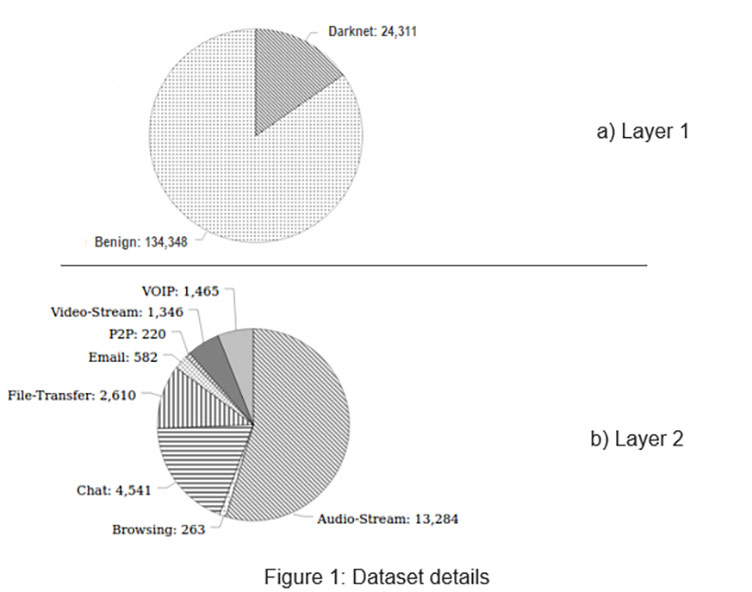

# CIC-Darknet2020

Darknet is the unused address space of the internet which is not speculated to interact with other computers in the world. Any communication from the dark space is considered sceptical owing to its passive listening nature which accepts incoming packets, but outgoing packets are not supported. Due to the absence of legitimate hosts in the darknet, any traffic is contemplated to be unsought and is characteristically treated as probe, backscatter or misconfiguration. Darknets are also known as network telescopes, sinkholes or blackholes.

Darknet traffic classification is significantly important to categorize real-time applications. Analyzing darknet traffic helps in early monitoring of malware before onslaught and detection of malicious activities after outbreak.

This research work proposes a novel technique to detect and characterize VPN and Tor applications together as the real representative of darknet traffic by amalgamating out two public datasets, namely, [ISCXTor2016](https://www.unb.ca/cic/datasets/tor.html) and [ISCXVPN2016](https://www.unb.ca/cic/datasets/vpn.html), to create a complete darknet dataset covering Tor and VPN traffic respectively.

## 1. Introduction

In CICDarknet2020 dataset, a two-layered approach is used to generate benign and darknet traffic at the first layer. The darknet traffic constitutes Audio-Stream, Browsing, Chat, Email, P2P, Transfer, Video-Stream and VOIP which is generated at the second layer. To generate the representative dataset, we amalgamated our previously generated datasets, namely, ISCXTor2016 and ISCXVPN2016, and combined the respective VPN and Tor traffic in corresponding Darknet categories. Table 1 provides the details of darknet traffic categories, and the applications used to generate the network traffic.

*Table 1: Darknet Network Traffic Details*

|Traffic Category|	Applications used|
|----------|----------|
|Audio-Stream|	Vimeo and Youtube|
|Browsing|	Firefox and Chrome|
|Chat|	ICQ, AIM, Skype, Facebook and Hangouts|
|Email|	SMTPS, POP3S and IMAPS|
|P2P|	uTorrent and Transmission (BitTorrent)|
|Transfer|	Skype, FTP over SSH (SFTP) and FTP over SSL (FTPS) using Filezilla and an external service|
|Video-Stream|	Vimeo and Youtube|
|VOIP|	Facebook, Skype and Hangouts voice calls|

## 2. Dataset details

Based on the combining explanation in previous section, Figure 1 (a) presents the details of number of samples of benign and darknet traffic at first layer and (b) highlights the number of encrypted flows in our darknet traffic.

YouTube video: [Dark Web Monitoring and Detection](https://youtu.be/1D92mdpXCuM) by Dr. Arash Habibi Lashkari

## 3. License

You may redistribute, republish and mirror the CICDarknet2020 dataset in any form. However, any use or redistribution of data must include a citation to the CICDarknet2020 dataset and the following paper.

> Arash Habibi Lashkari, Gurdip Kaur, and Abir Rahali, “DIDarknet: A Contemporary Approach to Detect and Characterize the Darknet Traffic using Deep Image Learning”, 10th International Conference on Communication and Network Security, Tokyo, Japan, November 2020.

## Acknowledgements

We thank the Mitacs Globalink Program for providing the Research Internship (GRI) opportunity to propose deep image learning model that we used in this research paper and Fredrik and Catherine Eaton Visitorship research fund from University of New Brunswick.
