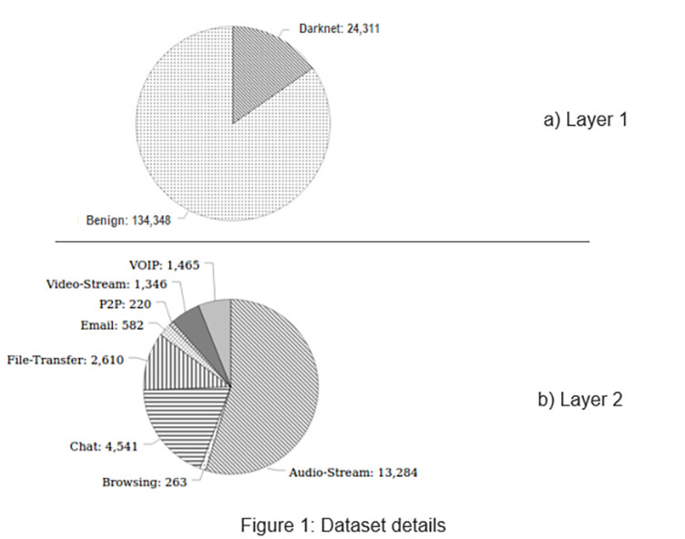

# 暗网流量公开数据集

## CIC-Darknet2020
### 简介
CICDarknet2020数据集分为两层，在第一层生成普通流量和暗网流量，第二层为暗网流量，包括音频流、视频流、Web浏览、即时通信、电子邮件、P2P、文件传输和VOIP。该数据是ISCXTor2016和ISCXVPN2016数据集合并而来，结合了两者相应暗网类别中各自的VPN和Tor流量。第二层暗网流量的八种分类的流量源程序和详细信息如表1所示。

*表 1: 第二层暗网流量分类详情*

|流量类别|	源程序|
|----------|----------|
|Audio-Stream|	Vimeo and Youtube|
|Browsing|	Firefox and Chrome|
|Chat|	ICQ, AIM, Skype, Facebook and Hangouts|
|Email|	SMTPS, POP3S and IMAPS|
|P2P|	uTorrent and Transmission (BitTorrent)|
|Transfer|	Skype, FTP over SSH (SFTP) and FTP over SSL (FTPS) using Filezilla and an external service|
|Video-Stream|	Vimeo and Youtube|
|VOIP|	Facebook, Skype and Hangouts voice calls|

### 数据集内容
[数据集链接](https://www.unb.ca/cic/datasets/darknet2020.html)
基于上节的描述，图1展示了第一层数据集中正常流量和暗网流量的样本量对比情况，以及第二层数据集中各个类别样本量的占比情况。



### 相关论文
> Arash Habibi Lashkari, Gurdip Kaur, and Abir Rahali, “DIDarknet: A Contemporary Approach to Detect and Characterize the Darknet Traffic using Deep Image Learning”, 10th International Conference on Communication and Network Security, Tokyo, Japan, November 2020.

### 研究团队
> University of New Brunswick - Canadian Institute for Cybersecurity

加拿大网络安全研究所(CIC)位于弗雷德里克顿的新不伦瑞克大学，是一个综合性的多学科培训、研发和创业单位，吸收了社会科学、商业、计算机科学、工程、法律和科学领域的研究人员的专业知识。CIC关注的是安全数据的价值和意义，该研究所的网络安全科学项目侧重于为不断发展的数据密集型网络领域开发信息和网络安全解决方案，该计划的重点是开发和实施应对网络空间安全挑战的新方法，该研究解决了网络空间基础设施在恶意和不确定环境下确保其生存能力、可靠性和性能目标所面临的实际安全问题。

---

## obfs4-mingan
### 简介
由9个子集组成：每个子集包含10000个实例，对应一个传输场景。对于每个子集，它包含两个部分：TCP数据和cell数据。TCP数据包含每个TCP报文的方向和时间信息，cell数据包含cell方向、时间戳和电路用途。

### 数据集内容
数据集链接：[网盘](https://pan.baidu.com/s/1kafKyemzmdEsyRnFlrV8NQ)，
提取密码：`2rfw`

其中，clientdata是访问网站内容的流，cliententrp是访问隐藏服务内容的流，createfast是下载缓存文件的流。对于每个跟踪，在TCP文件夹中有一个记录TCP序列的txt文件，在日志文件夹中有一个同名的对应Tor日志文件。各个文件名的第一个数字是目标域的类型(0代表clientdata, 1代表clientp, 2代表createfast)。

```
dataset_Obfs4-MingAn
├── log
│   ├── client0_server0
│   ├── client0_server1
│   ├── client0_server2
│   ├── client1_server0
│   ├── client1_server1
│   ├── client1_server2
│   ├── client2_server0
│   ├── client2_server1
│   └── client2_server2
└── tcp
    ├── client0_server0
    ├── client0_server1
    ├── client0_server2
    ├── client1_server0
    ├── client1_server1
    ├── client1_server2
    ├── client2_server0
    ├── client2_server1
    └── client2_server2
```

### 相关论文
> Wang, Xuebin, et al. "Towards comprehensive analysis of tor hidden service access behavior identification under obfs4 scenario." Proceedings of the 2021 ACM International Conference on Intelligent Computing and its Emerging Applications. 2021.

### 研究团队
北京邮电大学网络空间安全学院网络安全与治理中心时金桥教授团队长期从事计算机网络与分布式系统、网络与信息安全相关项目科研工作，主要研究兴趣包括分布式网络系统、匿名通信与隐私保护、区块链网络、信息智能处理、大数据智能分析、网络测量技术等。
