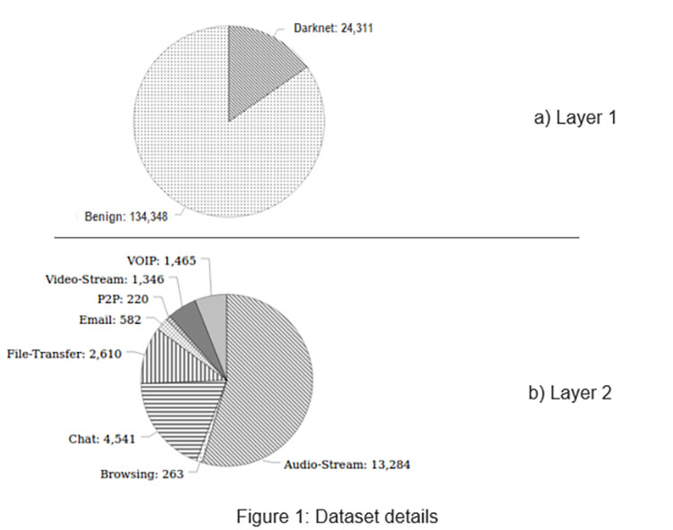

# Dark web datasets

## Self-made extremely low proportion Tor traffic datasets

```txt
cet30_pure_tor + mawi + vant + tcub_non_tor
cicdarknet + mawi + vant + tcub_non_tor
tcub_tor + mawi + vant + tcub_non_tor
```

## CIC-Darknet2020
### Introduction
In CICDarknet2020 dataset, a two-layered approach is used to generate benign and darknet traffic at the first layer. The darknet traffic constitutes Audio-Stream, Browsing, Chat, Email, P2P, Transfer, Video-Stream and VOIP which is generated at the second layer. To generate the representative dataset, we amalgamated our previously generated datasets, namely, ISCXTor2016 and ISCXVPN2016, and combined the respective VPN and Tor traffic in corresponding Darknet categories. Table 1 provides the details of darknet traffic categories, and the applications used to generate the network traffic.

*Table 1: Darknet Network Traffic Details*

|Traffic Category|	Applications used|
|----------|----------|
|Audio-Stream|	Vimeo and Youtube|
|Browsing|	Firefox and Chrome|
|Chat|	ICQ, AIM, Skype, Facebook and Hangouts|
|Email|	SMTPS, POP3S and IMAPS|
|P2P|	uTorrent and Transmission (BitTorrent)|
|Transfer|	Skype, FTP over SSH (SFTP) and FTP over SSL (FTPS) using Filezilla and an external service|
|Video-Stream|	Vimeo and Youtube|
|VOIP|	Facebook, Skype and Hangouts voice calls|

### Dataset details
Based on the combining explanation in previous section, Figure 1 (a) presents the details of number of samples of benign and darknet traffic at first layer and (b) highlights the number of encrypted flows in our darknet traffic.



### Related paper(s)
> Arash Habibi Lashkari, Gurdip Kaur, and Abir Rahali, “DIDarknet: A Contemporary Approach to Detect and Characterize the Darknet Traffic using Deep Image Learning”, 10th International Conference on Communication and Network Security, Tokyo, Japan, November 2020.

### Research team
> University of New Brunswick - Canadian Institute for Cybersecurity

The institute’s program on the science of cybersecurity focuses on enabling the development of information and network security solutions for the evolving data-intensive cyber domain. CIC focuses on the value and meaning of security data.

The focus of the program is on development and implementation of novel approaches for addressing the timely security challenges in cyberspace. The research addresses practical security problems that cyberspace infrastructure face in ensuring their survivability, reliability and performance objectives under malicious and uncertain environments.

---

## obfs4-mingan
### Introduction
Obfs4-MingAn, consisting of 9 subsets: each subset contains 10,000 instances, corresponding to one transmission scenario. For each subsets, it contains two parts: TCP data and cell data. TCP data contains both direction and time information of each TCP packet, and cell data contains cell direction, timestamp and circuit purpose.

### Dataset details
Dataset link：[BaiduNetdisk](https://pan.baidu.com/s/1kafKyemzmdEsyRnFlrV8NQ), 
Extraction code：`2rfw`

**clientdata** is the stream related to accessing website content, **clientrp** is the stream related to accessing hidden service content, and **createfast** is the stream related to downloading cached files.

For each trace, there is a txt file recording the TCP sequence in the tcp folder, and a corresponding Tor log file in the log folder with the same name. The first number of the filename is the type of target domain(0 for clientdata, 1 for clientrp, and 2 for clientfast).

For example, the following **TCP sequence file** and  **Tor log file** come from the same trace, and the target domain is clientdata.

### Related paper(s)
> Wang, Xuebin, et al. "Towards comprehensive analysis of tor hidden service access behavior identification under obfs4 scenario." Proceedings of the 2021 ACM International Conference on Intelligent Computing and its Emerging Applications. 2021.

### Research team
Professor Shi Jinqiao of Network Security and Governance Center, School of Cyberspace Security, Beijing University of Posts and Telecommunications has long been engaged in research on computer networks and distributed systems, network and information security related projects. His and his team's main research interests include distributed network systems, anonymous communication and privacy protection, blockchain network, information intelligent processing, big data intelligent analysis, network measurement technology, etc.
